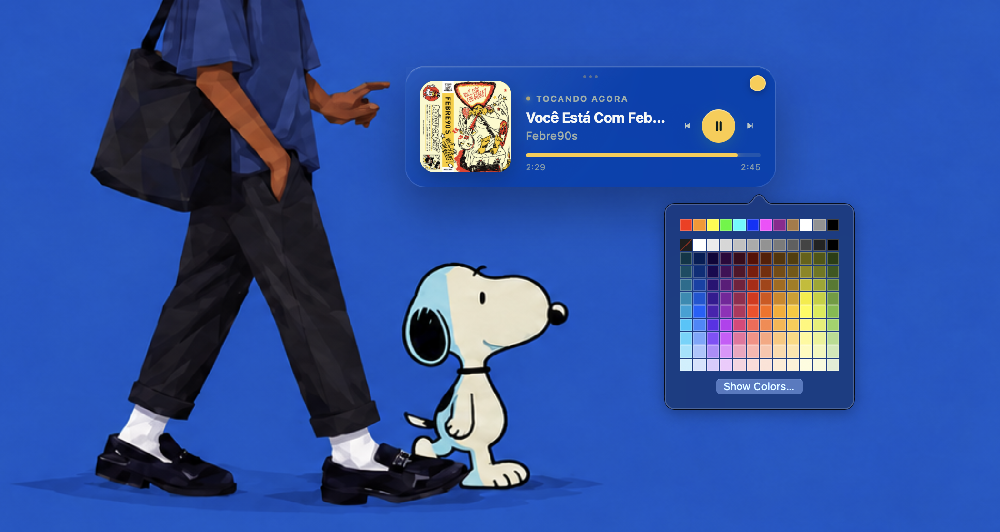
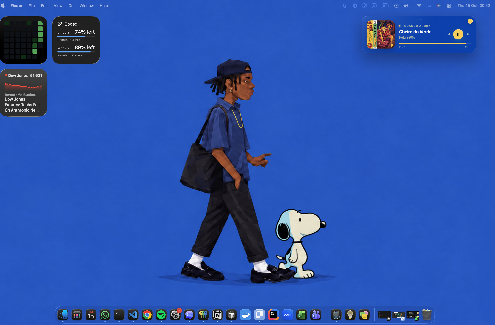

# Spotify Desktop Widget para macOS

Mini player do Spotify para a área de trabalho do macOS, construído para o [Übersicht](https://tracesof.net/uebersicht/). Ele consulta e controla o aplicativo Spotify instalado no Mac usando AppleScript localmente.

Não utiliza Spotify Web API, OAuth, servidor backend, Electron ou credenciais da sua conta.

> Este projeto é um widget do **Übersicht**. Ele não é um widget nativo do WidgetKit e não aparece na Central de Notificações ou na galeria de widgets do macOS.

<p align="center">
  <a href="./image-3.png">
    
  </a>
</p>

<p align="center">
  <sub>Layout Compact — vidro translúcido, controles locais e cor personalizável.</sub>
</p>

## O que o widget oferece

- música, artista, álbum e capa atuais;
- duração e posição da reprodução;
- estados reproduzindo, pausado, parado, fechado e erro de permissão;
- play, pause, faixa anterior e próxima faixa;
- alteração da posição clicando na barra de progresso;
- atualização a cada 1 segundo e resposta visual imediata aos controles;
- layouts Compact, Classic e Minimal;
- vidro translúcido que deixa as cores do papel de parede aparecerem;
- seletor de cor para botões, progresso e indicadores;
- posição livre por arrastar, salva entre reinicializações;
- fallback para capa ausente e metadados incompletos;
- títulos longos protegidos por truncamento;
- funcionamento inteiramente local via AppleScript.

### Integrado ao seu desktop

<p align="center">
  <a href="./image.png">
    
  </a>
</p>

<p align="center">
  <sub>Posicione onde preferir sem esconder o papel de parede ou bloquear seus aplicativos.</sub>
</p>

## O que precisa ser instalado

### Obrigatório

| Item | Para que serve | Download |
|---|---|---|
| macOS 12 ou mais recente | Sistema compatível com as versões atuais do Übersicht | Já incluído no Mac |
| Spotify Desktop | Fonte da reprodução e dos controles | [spotify.com/download](https://www.spotify.com/download/mac/) |
| Übersicht | Renderiza o widget diretamente no desktop | [tracesof.net/uebersicht](https://tracesof.net/uebersicht/) |

Apple Silicon e Intel são suportados. Não é necessário Spotify Premium para exibir o estado; algumas ações podem seguir as limitações normais da conta e do conteúdo reproduzido.

### Opcional

| Item | Quando é necessário |
|---|---|
| [Homebrew](https://brew.sh/) | Para instalar o Übersicht pelo Terminal |
| Node.js 18 ou mais recente | Somente para executar os testes automatizados |
| VS Code | Para editar configuração e código com mais facilidade |

O widget em execução não depende do Node.js instalado pelo usuário e não exige `npm install`.

## Instalação completa

### 1. Confirmar ou instalar o Spotify

Se o Spotify já estiver em `/Applications/Spotify.app`, avance para a próxima etapa.

Para confirmar pelo Terminal:

```bash
test -d "/Applications/Spotify.app" && echo "Spotify instalado" || echo "Spotify não encontrado"
```

Caso não esteja instalado, baixe o aplicativo em [spotify.com/download](https://www.spotify.com/download/mac/), mova-o para Aplicativos e abra-o pelo menos uma vez:

```bash
open -a Spotify
```

Faça login normalmente no Spotify e inicie uma música para o primeiro teste.

### 2. Instalar o Übersicht

#### Opção A — Homebrew

Confira se o Homebrew está disponível:

```bash
brew --version
```

Se o comando não existir, instale o Homebrew usando as instruções atuais de [brew.sh](https://brew.sh/). Em seguida:

```bash
brew install --cask ubersicht
open -a Übersicht
```

#### Opção B — Instalação manual

1. Baixe o Übersicht em [tracesof.net/uebersicht](https://tracesof.net/uebersicht/).
2. Abra o arquivo baixado.
3. Mova `Übersicht.app` para `/Applications`.
4. Abra o aplicativo pelo Finder ou execute:

```bash
open -a Übersicht
```

Na primeira abertura, o ícone do Übersicht deve aparecer na barra de menus do macOS.

### 3. Localizar este projeto

Abra o Terminal na pasta onde o projeto foi baixado ou clonado. Neste ambiente, o caminho é:

```bash
cd "/Users/leonardopires/workspace/projects/spotify-desktop"
```

Em outro Mac, substitua pelo caminho correspondente. Confirme que o pacote existe:

```bash
test -f "spotify-desktop.widget/spotify-desktop.jsx" && echo "Widget encontrado"
```

Se aparecer `No such file or directory`, você está na pasta errada. Use `pwd` para ver a pasta atual e `ls` para listar seu conteúdo.

### 4. Abrir a pasta de widgets

No ícone do Übersicht na barra de menus, selecione **Open Widgets Folder**. O caminho padrão é:

```text
~/Library/Application Support/Übersicht/widgets
```

Também é possível criar e abrir a pasta pelo Terminal:

```bash
mkdir -p "$HOME/Library/Application Support/Übersicht/widgets"
open "$HOME/Library/Application Support/Übersicht/widgets"
```

### 5. Instalar o widget

Escolha apenas um dos métodos abaixo.

#### Método recomendado para desenvolvimento — link simbólico

Alterações feitas no projeto são refletidas automaticamente no Übersicht:

```bash
ln -s \
  "$(pwd)/spotify-desktop.widget" \
  "$HOME/Library/Application Support/Übersicht/widgets/spotify-desktop.widget"
```

#### Método recomendado para uso independente — cópia

Cria uma cópia independente dentro do Übersicht:

```bash
cp -R \
  "spotify-desktop.widget" \
  "$HOME/Library/Application Support/Übersicht/widgets/"
```

Se o Terminal informar `File exists`, já existe uma instalação com esse nome. Não execute comandos destrutivos às cegas: abra a pasta com **Open Widgets Folder**, confira o conteúdo e mova a versão antiga para um local de backup antes de repetir a instalação.

Confirme a instalação:

```bash
ls -la "$HOME/Library/Application Support/Übersicht/widgets/spotify-desktop.widget"
```

O diretório deve continuar chamado exatamente `spotify-desktop.widget`, pois os comandos internos utilizam esse nome.

### 6. Carregar o widget

1. Abra o menu do Übersicht.
2. Confirme que `spotify-desktop` está habilitado na lista de widgets.
3. Escolha **Refresh All Widgets**.
4. O player deverá aparecer inicialmente próximo ao canto superior direito.

O Übersicht observa os arquivos do widget. Em uma instalação por link simbólico, mudanças normalmente aparecem sem uma nova cópia.

## Permissões do macOS

São necessárias duas permissões diferentes: Automação para controlar o Spotify e Acessibilidade para interagir com o widget.

### Permitir Automação do Spotify

Quando o widget tentar consultar o Spotify pela primeira vez, o macOS poderá perguntar se o Übersicht pode controlar o Spotify. Aceite.

Para conferir manualmente:

1. Abra **Ajustes do Sistema**.
2. Entre em **Privacidade e Segurança → Automação**.
3. Localize **Übersicht**.
4. Habilite **Spotify**.
5. Feche e abra o Übersicht novamente se a mudança não surtir efeito.

Executar um AppleScript pelo Terminal pode criar uma autorização separada para Terminal → Spotify. Essa permissão não substitui Übersicht → Spotify.

### Permitir interação com o widget

O Übersicht normalmente deixa o mouse passar através dos widgets para não bloquear o desktop. Para clicar, arrastar ou escolher cores:

1. Abra as preferências do Übersicht.
2. Configure um **Interaction Shortcut**.
3. Abra **Ajustes do Sistema → Privacidade e Segurança → Acessibilidade**.
4. Habilite **Übersicht**.
5. Segure o Interaction Shortcut ao interagir com o widget.

Sem esse modo, o widget aparece e atualiza normalmente, mas os cliques e o arraste não são recebidos.

## Primeiro teste

### Testar somente a leitura do Spotify

Na raiz do projeto:

```bash
cd "/Users/leonardopires/workspace/projects/spotify-desktop"
osascript "spotify-desktop.widget/scripts/spotify-status.applescript"
```

Se estiver em outro local, adapte o primeiro comando. Se você já estiver dentro de `spotify-desktop.widget`, use:

```bash
osascript "scripts/spotify-status.applescript"
```

Com uma música tocando, a resposta será um JSON semelhante a:

```json
{
  "ok": true,
  "appRunning": true,
  "state": "playing",
  "title": "Nome da música",
  "artist": "Nome do artista",
  "durationMs": 240000,
  "positionSec": 42.5
}
```

Respostas normais adicionais:

- `"state":"paused"`: música pausada;
- `"state":"stopped"`: Spotify aberto sem faixa ativa;
- `"state":"closed"`: Spotify fechado;
- `"errorCode":"permission_denied"`: Automação bloqueada pelo macOS.

### Testar os controles

Estes comandos atuam no Spotify real:

```bash
osascript "spotify-desktop.widget/scripts/spotify-control.applescript" play
osascript "spotify-desktop.widget/scripts/spotify-control.applescript" pause
osascript "spotify-desktop.widget/scripts/spotify-control.applescript" previous
osascript "spotify-desktop.widget/scripts/spotify-control.applescript" next
```

Seek usa milissegundos. Para ir até aproximadamente 30 segundos:

```bash
osascript "spotify-desktop.widget/scripts/spotify-control.applescript" seek 30000
```

O uso de milissegundos inteiros evita ambiguidades entre vírgula e ponto em diferentes configurações regionais do macOS.

## Como usar

### Controles

- botão central: play ou pause;
- botão esquerdo: faixa anterior;
- botão direito: próxima faixa;
- barra de progresso: clique em uma posição para fazer seek;
- círculo colorido no canto superior direito: abre o seletor de cor.

Os botões e a barra usam a mesma cor selecionada.

### Mover o widget

Com o Interaction Shortcut pressionado:

1. Clique em uma área livre do player.
2. Arraste para qualquer posição dentro da tela.
3. Solte para salvar a posição.

A posição permanece salva depois de reiniciar o Übersicht. Dê duplo clique no fundo do player para retornar à posição definida em `config.js`.

### Trocar a cor dos controles

1. Ative o modo de interação.
2. Clique no pequeno círculo colorido no canto superior direito.
3. Escolha uma cor no seletor do macOS.

A escolha é aplicada a play/pause, barra de progresso, indicadores e detalhes, e fica salva localmente. `accentColor` representa apenas o padrão inicial.

## Personalização

Edite [`spotify-desktop.widget/src/config.js`](spotify-desktop.widget/src/config.js):

```js
export const config = Object.freeze({
  layout: "compact",
  position: {
    top: "42px",
    right: "42px",
    bottom: "auto",
    left: "auto",
  },
  width: 390,
  opacity: 0.34,
  accentColor: "#7DD3FC",
  showProgress: true,
  refreshInterval: 1000,
  animations: true,
  deriveColorFromArtwork: false,
  draggable: true,
});
```

### Referência das opções

| Opção | Valores | Descrição |
|---|---|---|
| `layout` | `"compact"`, `"classic"`, `"minimal"` | Seleciona o formato do player |
| `position.top` | comprimento CSS ou `"auto"` | Distância inicial do topo |
| `position.right` | comprimento CSS ou `"auto"` | Distância inicial da direita |
| `position.bottom` | comprimento CSS ou `"auto"` | Distância inicial da parte inferior |
| `position.left` | comprimento CSS ou `"auto"` | Distância inicial da esquerda |
| `width` | número em pixels | Largura total do widget |
| `opacity` | número de `0` a `1` | Opacidade da película de vidro |
| `accentColor` | hexadecimal CSS | Cor inicial dos controles |
| `showProgress` | `true` ou `false` | Exibe ou oculta progresso e tempos |
| `refreshInterval` | milissegundos | Intervalo das consultas ao Spotify |
| `animations` | `true` ou `false` | Ativa transições e crossfade |
| `deriveColorFromArtwork` | `true` ou `false` | Tenta obter cores dominantes da capa |
| `draggable` | `true` ou `false` | Permite reposicionar arrastando |

Use apenas uma âncora vertical (`top` ou `bottom`) e uma horizontal (`left` ou `right`). Defina as âncoras opostas como `"auto"`.

### Layouts

**Compact** é o padrão horizontal, com capa, informações, três controles e progresso:

```js
layout: "compact",
width: 390,
```

**Classic** é o mini player vertical com capa grande e controles centralizados:

```js
layout: "classic",
width: 320,
```

**Minimal** mostra miniatura, título e play/pause:

```js
layout: "minimal",
width: 280,
```

### Transparência

O valor padrão `0.34` permite que as cores do papel de parede atravessem o vidro:

```js
opacity: 0.20, // muito transparente
opacity: 0.34, // padrão equilibrado
opacity: 0.65, // maior contraste
```

O efeito também depende do suporte do WebKit a `backdrop-filter` e das cores do papel de parede.

### Frequência de atualização

```js
refreshInterval: 1000, // resposta rápida, padrão
refreshInterval: 2000, // menor atividade de CPU
```

Valores abaixo de 500 ms não são recomendados, pois iniciam AppleScript com frequência alta sem benefício visual proporcional. Os controles fazem uma consulta imediata depois de uma ação, independentemente do intervalo.

### Cores derivadas da capa

Essa função está desligada por padrão para manter o vidro neutro:

```js
deriveColorFromArtwork: false,
```

Ao usar `true`, o widget tenta extrair três cores da capa usando um canvas de 18×18 pixels. Servidores de imagem podem bloquear essa leitura por CORS; nesse caso o widget mantém a aparência configurada sem quebrar.

## Inicialização automática

Método preferencial:

1. Abra as preferências do Übersicht.
2. Ative **Launch at Login**.

Alternativa pelo macOS:

1. Abra **Ajustes do Sistema → Geral → Itens de Início**.
2. Adicione `/Applications/Übersicht.app`.

O Spotify não precisa necessariamente iniciar com o sistema. Enquanto estiver fechado, o widget exibe o estado correspondente.

## Testes automatizados

Os testes usam apenas o runner nativo do Node.js. Não é necessário instalar pacotes.

```bash
cd "/Users/leonardopires/workspace/projects/spotify-desktop/spotify-desktop.widget"
npm test
```

Os testes cobrem parsing, metadados especiais, comandos permitidos, seek seguro, estado otimista dos controles, mudança de capa, arraste, paleta e validação de cores.

Compilar os AppleScripts separadamente:

```bash
osacompile -o /tmp/spotify-status.scpt scripts/spotify-status.applescript
osacompile -o /tmp/spotify-control.scpt scripts/spotify-control.applescript
```

## Checklist de validação manual

- [ ] Spotify fechado mostra “Spotify está fechado”.
- [ ] Spotify aberto sem faixa mostra “Nada tocando”.
- [ ] Música tocando mostra capa, título, artista e progresso.
- [ ] Pause altera o estado visual imediatamente.
- [ ] Play volta a reproduzir.
- [ ] Anterior e próxima trocam a música.
- [ ] Mudança de faixa atualiza e faz crossfade da capa.
- [ ] Clique na barra altera a posição.
- [ ] Capa ausente mostra o ícone de fallback.
- [ ] Título longo termina em reticências sem quebrar o layout.
- [ ] O seletor altera botões e progresso para a mesma cor.
- [ ] O widget pode ser arrastado e mantém a posição.
- [ ] Os três layouts aparecem corretamente.
- [ ] Bloquear Automação resulta em estado de permissão, sem quebrar a interface.

## Solução de problemas

### `No such file or directory`

O Terminal não está na raiz do projeto ou o caminho está incorreto. Use:

```bash
pwd
ls
find . -name "spotify-status.applescript" -print
```

Depois execute o script com o caminho retornado ou use o caminho absoluto entre aspas.

### O widget não aparece

Confirme:

```bash
ls -la "$HOME/Library/Application Support/Übersicht/widgets/spotify-desktop.widget"
```

O pacote precisa conter `spotify-desktop.jsx` diretamente na raiz. Depois:

1. confirme que o widget está habilitado no menu do Übersicht;
2. use **Refresh All Widgets**;
3. feche e abra o Übersicht;
4. confira se a pasta termina em `.widget`.

### O widget aparece, mas não mostra a música

1. Abra o Spotify e inicie uma música.
2. Execute `spotify-status.applescript` manualmente.
3. Confira Automação → Übersicht → Spotify.
4. Reinicie Spotify e Übersicht.

### Os botões não respondem

- segure o Interaction Shortcut;
- habilite o Übersicht em Acessibilidade;
- habilite Spotify dentro da Automação do Übersicht;
- teste `spotify-control.applescript` pelo Terminal.

### Não é possível arrastar

- confirme `draggable: true`;
- ative o modo de interação;
- arraste uma área livre, não um botão ou a barra de progresso;
- confira a permissão de Acessibilidade.

### A posição sempre volta

A posição é armazenada no armazenamento local da WebView. Mudanças de domínio interno, limpeza dos dados do Übersicht ou reinstalação podem removê-la. Dê duplo clique no player para retornar intencionalmente à posição do arquivo de configuração.

### A cor não muda

- ative o modo de interação;
- clique no círculo colorido no canto superior direito;
- escolha uma cor e feche o seletor;
- use **Refresh All Widgets** se o seletor não estiver visível.

Uma cor salva anteriormente tem prioridade sobre `accentColor`. Para voltar ao padrão, selecione manualmente o mesmo hexadecimal configurado.

### A barra começa com uma cor diferente

A barra inteira utiliza `--accent`, a mesma variável do seletor. Se ainda houver uma versão antiga visível, use **Refresh All Widgets** ou reinicie o Übersicht.

### A capa não aparece

Podcasts, anúncios e algumas mídias podem não oferecer URL de capa. Falha de rede também pode impedir o carregamento. O widget mostra um fallback e continua funcional.

### Seek não funciona

O conteúdo precisa fornecer duração e aceitar mudança de posição. Alguns anúncios, transmissões e conteúdos controlados pelo Spotify não permitem seek.

### Uso de CPU ou RAM

O Übersicht compartilha seus processos WebKit entre widgets, então o consumo exato deste widget não aparece como um processo separado. Para reduzir atividade de CPU, aumente `refreshInterval` para `2000` ou mais. Isso não altera significativamente o uso de RAM, mas reduz a frequência do AppleScript.

Use o Monitor de Atividade e pesquise por `Übersicht` e `WebKit` para acompanhar o consumo total.

## Atualizar o widget

### Instalação por link simbólico

Edite ou atualize o projeto original e escolha **Refresh All Widgets**. Não é necessário copiar novamente.

### Instalação por cópia

1. Feche o Übersicht.
2. Faça backup da pasta instalada.
3. Substitua a pasta `spotify-desktop.widget` pela nova versão.
4. Abra o Übersicht e selecione **Refresh All Widgets**.

O arquivo `src/config.js` pode conter personalizações; copie seus valores para a versão nova quando necessário.

## Desinstalar

Para remover somente o widget:

1. No Übersicht, escolha **Open Widgets Folder**.
2. Mova `spotify-desktop.widget` para a Lixeira.
3. Use **Refresh All Widgets**.

Para remover também o Übersicht instalado pelo Homebrew:

```bash
brew uninstall --cask ubersicht
```

O Spotify não é removido e nenhuma configuração da conta é alterada.

## Segurança e privacidade

- toda comunicação com o Spotify ocorre localmente via AppleScript;
- nenhuma credencial do Spotify é lida ou armazenada;
- não há Spotify Web API, OAuth ou servidor externo;
- ações de reprodução são limitadas por uma whitelist;
- metadados de músicas nunca são usados para construir comandos de shell;
- a posição e a cor escolhida são armazenadas apenas localmente pela WebView do Übersicht.

## Estrutura do projeto

```text
spotify-desktop.widget/
├── spotify-desktop.jsx          # entrada, polling, reducer e estilos
├── package.json                 # comando de teste, sem dependências
├── widget.json                  # metadados do widget
├── scripts/
│   ├── spotify-status.applescript
│   └── spotify-control.applescript
├── src/
│   ├── components/
│   │   ├── Artwork.jsx
│   │   ├── Controls.jsx
│   │   ├── Icons.jsx
│   │   ├── Player.jsx
│   │   └── Progress.jsx
│   ├── config.js                # preferências editáveis
│   ├── drag.js                  # posição persistente
│   ├── spotify.js               # parsing e whitelist de comandos
│   ├── theme.js                 # seletor e persistência da cor
│   └── utils.js                 # tempo, progresso e paleta
└── test/
    └── spotify.test.js
```

Os módulos ficam em `src/`, uma pasta tratada pelo Übersicht como código auxiliar em vez de widgets separados.

## Limitações conhecidas

- a atualização periódica existe porque o AppleScript do Spotify não oferece um stream de eventos para o widget;
- cliques e arraste dependem do Interaction Shortcut do Übersicht;
- a paleta da capa depende da política CORS do servidor da imagem e está desativada por padrão;
- anúncios e alguns conteúdos podem omitir metadados ou impedir seek;
- o consumo de memória não pode ser atribuído exatamente por widget porque os processos WebKit são compartilhados;
- este projeto não aparece na galeria de widgets nativos do macOS.

## Referências

- [Site oficial do Übersicht](https://tracesof.net/uebersicht/)
- [Documentação oficial para criação de widgets](https://github.com/felixhageloh/uebersicht#writing-widgets)
- [Cask oficial do Übersicht no Homebrew](https://formulae.brew.sh/cask/ubersicht)
- [Download oficial do Spotify para macOS](https://www.spotify.com/download/mac/)
